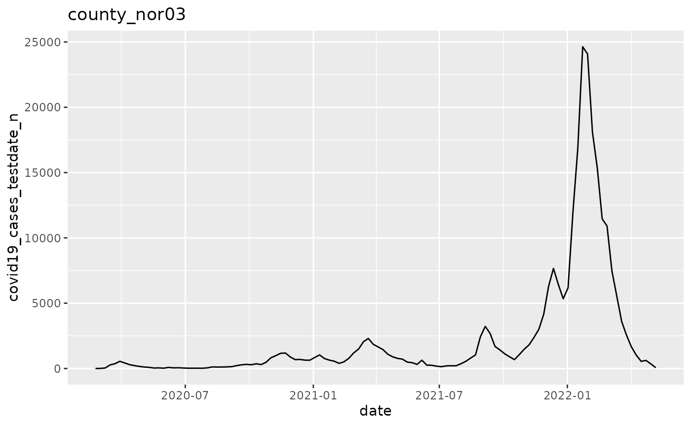
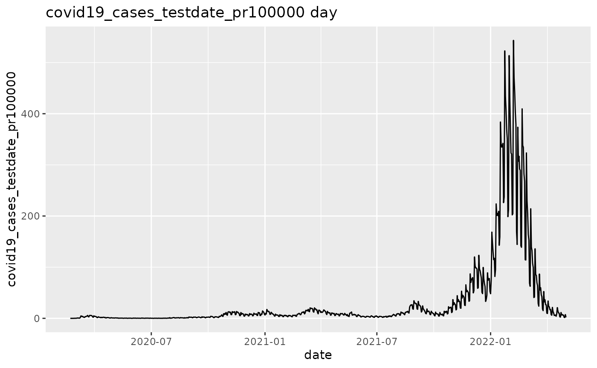
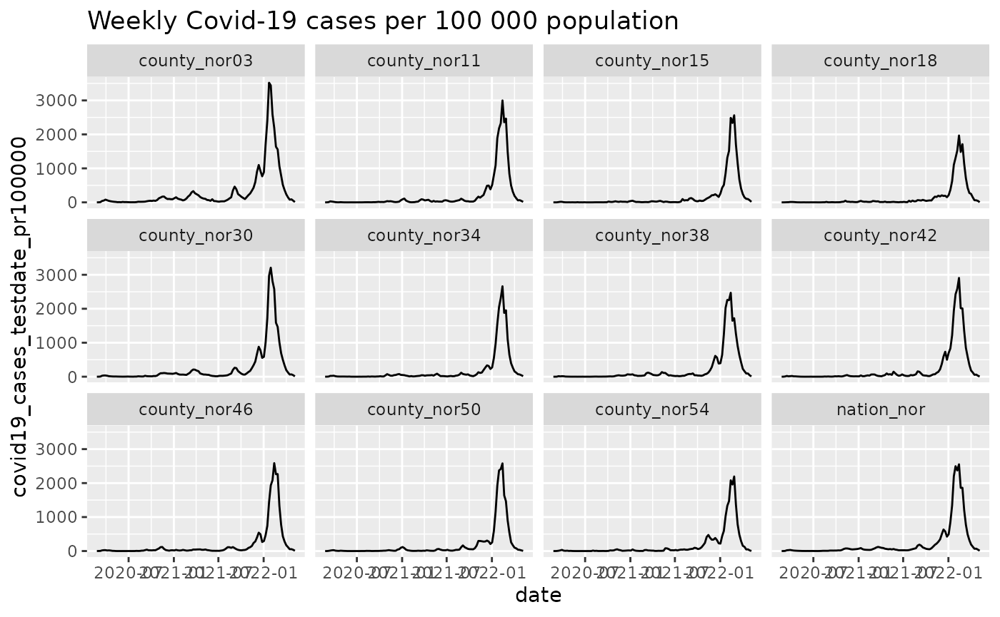

# Adding analyses to a plan

This vignette builds three plans on
`nor_covid19_cases_by_time_location`, a dataset of Covid-19 cases in
Norway.
[`vignette("plnr")`](https://www.rwhite.no/plnr/articles/plnr.md)
defines the terms: argset, action function, analysis and plan.

## Single-function plan

A single-function plan applies one action function to many argsets. Add
the argsets first. Then give every argset the same action function with
`apply_action_fn_to_all_argsets()`.

### Many strata

This plan draws one graph for each location.

``` r
library(ggplot2)
library(data.table)
```

    ## 
    ## Attaching package: 'data.table'

    ## The following object is masked from 'package:base':
    ## 
    ##     %notin%

``` r
p <- plnr::Plan$new()

data_fn <- function() {
  return(plnr::nor_covid19_cases_by_time_location)
}
p$add_data(name = "covid19_cases", fn_name = "data_fn")

location_codes <- unique(p$get_data()$covid19_cases$location_code)
location_codes
```

    ##  [1] "county_nor03" "county_nor11" "county_nor15" "county_nor18" "county_nor30"
    ##  [6] "county_nor34" "county_nor38" "county_nor42" "county_nor46" "county_nor50"
    ## [11] "county_nor54" "nation_nor"

``` r
p$add_argset_from_list(
  plnr::expand_list(
    location_code = location_codes,
    granularity_time = "isoweek"
  )
)
p$get_argsets_as_dt()
```

    ##                            name_analysis index_analysis location_code
    ##                                   <char>          <int>        <list>
    ##  1: 67198869-2100-4584-8b67-330c3896a046              1  county_nor03
    ##  2: 33c6fe21-17ad-4e66-b8cc-eaf5a4176d3c              2  county_nor11
    ##  3: 0f68b75c-b25a-470d-a87f-0552c4998a8f              3  county_nor15
    ##  4: f6515b4f-c78f-4bb2-999c-7c687920432a              4  county_nor18
    ##  5: 435af87a-cccd-491c-ae36-870117369c01              5  county_nor30
    ##  6: 512139f4-de21-4d19-bb76-7f82e301d8f2              6  county_nor34
    ##  7: b5e50cde-5fbb-4112-88fe-b0bd41b3976a              7  county_nor38
    ##  8: c3f28077-a3f1-41c6-b082-fa9cd203256b              8  county_nor42
    ##  9: d8144421-b8f9-4a41-9c39-996ef2b513a5              9  county_nor46
    ## 10: fff7523f-bbce-45bd-a057-4c9dbaa3ad93             10  county_nor50
    ## 11: 3cb11f96-2e63-4312-afb1-10662aea80ce             11  county_nor54
    ## 12: cfd368df-e761-4e01-be08-96fbc28ac408             12    nation_nor
    ##     granularity_time
    ##               <list>
    ##  1:          isoweek
    ##  2:          isoweek
    ##  3:          isoweek
    ##  4:          isoweek
    ##  5:          isoweek
    ##  6:          isoweek
    ##  7:          isoweek
    ##  8:          isoweek
    ##  9:          isoweek
    ## 10:          isoweek
    ## 11:          isoweek
    ## 12:          isoweek

``` r
action_fn <- function(data, argset) {
  if (plnr::is_run_directly()) {
    data <- p$get_data()
    argset <- p$get_argset(1)
  }
  pd <- data$covid19_cases[
    location_code == argset$location_code &
      granularity_time == argset$granularity_time
  ]

  q <- ggplot(pd, aes(x = date, y = covid19_cases_testdate_n))
  q <- q + geom_line()
  q <- q + labs(title = argset$location_code)
  q
}

p$apply_action_fn_to_all_argsets(fn_name = "action_fn")

q <- p$run_all()
q[[1]]
```



``` r
q[[2]]
```


### Many variables

This plan crosses two choices: cases or cases per 100 000 population,
and weekly or daily data. It draws one graph for each of the four
combinations.

``` r
p <- plnr::Plan$new()

data_fn <- function() {
  return(plnr::nor_covid19_cases_by_time_location[location_code == "nation_nor"])
}
p$add_data(name = "covid19_cases", fn_name = "data_fn")

p$add_argset_from_list(
  plnr::expand_list(
    variable = c("covid19_cases_testdate_n", "covid19_cases_testdate_pr100000"),
    granularity_time = c("isoweek", "day")
  )
)
p$get_argsets_as_dt()
```

    ##                           name_analysis index_analysis
    ##                                  <char>          <int>
    ## 1: ad3abf4a-573f-4d37-a276-1deb48b55337              1
    ## 2: e710f0f7-e1e3-4f25-963d-9da0153616d7              2
    ## 3: 31d86fa4-73c5-4ace-8d31-995901f41d55              3
    ## 4: bc899387-3918-4aea-9835-6b14cc5f7f92              4
    ##                           variable granularity_time
    ##                             <list>           <list>
    ## 1:        covid19_cases_testdate_n          isoweek
    ## 2:        covid19_cases_testdate_n              day
    ## 3: covid19_cases_testdate_pr100000          isoweek
    ## 4: covid19_cases_testdate_pr100000              day

``` r
action_fn <- function(data, argset) {
  if (plnr::is_run_directly()) {
    data <- p$get_data()
    argset <- p$get_argset(1)
  }
  pd <- data$covid19_cases[granularity_time == argset$granularity_time]

  q <- ggplot(pd, aes(x = date, y = .data[[argset$variable]]))
  q <- q + geom_line()
  q <- q + labs(title = paste(argset$variable, argset$granularity_time))
  q
}

p$apply_action_fn_to_all_argsets(fn_name = "action_fn")

p$run_one(1)
```


``` r
p$run_one(2)
```


``` r
p$run_one(3)
```


``` r
p$run_one(4)
```



## Multi-function plan

A multi-function plan gives each analysis its own action function. This
plan makes the figures of a short report. Figure 1 has its own action
function, and figures 2 and 3 share one.

``` r
p <- plnr::Plan$new()

data_fn <- function() {
  return(plnr::nor_covid19_cases_by_time_location)
}
p$add_data(name = "covid19_cases", fn_name = "data_fn")

figure_1 <- function(data, argset) {
  if (plnr::is_run_directly()) {
    data <- p$get_data()
    argset <- p$get_argset("figure_1")
  }
  pd <- data$covid19_cases[granularity_time == "isoweek"]

  q <- ggplot(pd, aes(x = date, y = covid19_cases_testdate_pr100000))
  q <- q + geom_line()
  q <- q + facet_wrap(~location_code)
  q <- q + labs(title = "Weekly Covid-19 cases per 100 000 population")
  q
}

plot_epicurve_by_location <- function(data, argset) {
  if (plnr::is_run_directly()) {
    data <- p$get_data()
    argset <- p$get_argset("figure_2")
  }
  pd <- data$covid19_cases[
    granularity_time == "isoweek" &
      location_code == argset$location_code
  ]

  q <- ggplot(pd, aes(x = date, y = covid19_cases_testdate_n))
  q <- q + geom_line()
  q <- q + labs(title = argset$location_code)
  q
}

p$add_analysis(name = "figure_1", fn_name = "figure_1")
p$add_analysis(
  name = "figure_2",
  fn_name = "plot_epicurve_by_location",
  location_code = "nation_nor"
)
p$add_analysis(
  name = "figure_3",
  fn_name = "plot_epicurve_by_location",
  location_code = "county_nor03"
)

p$run_one("figure_1")
```



``` r
p$run_one("figure_2")
```


``` r
p$run_one("figure_3")
```


