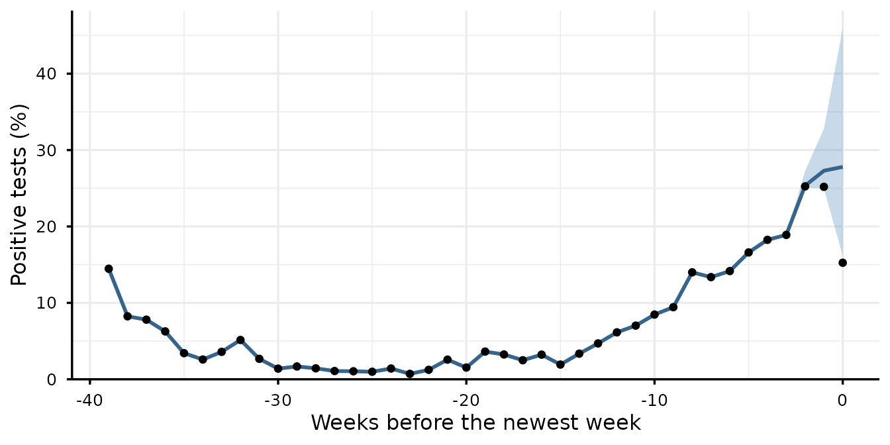

# Article 2: the methods are in packages

The surveillance methods are in R packages, separate from the pipeline.
The packages read tables that follow the data contract of [article
1](https://www.rwhite.no/plnr/articles/case-study-contract.md). This
article runs one methods package,
[csalert](https://niphr.github.io/csalert/), on one indicator.

A method in a package has a version, tests and documentation.

## The data

This article first runs the code of article 1 that makes the synthetic
registries and their tables. It does not print that code again. It then
takes the national influenza indicator of the laboratory:

``` r
library(csalert)

d <- check_contract(get_data_lab(), "lab")[indicator_tag == "lab_influenza"]
d[, .(reporting_dates = .N, positives = sum(numerator), tests = sum(denominator)), keyby = .(isoyearweek_reference)] |> tail(4)
#> Key: <isoyearweek_reference>
#>    isoyearweek_reference reporting_dates positives tests
#>                   <char>           <int>     <int> <int>
#> 1:               2023-52              23        89   471
#> 2:               2024-01              20       133   521
#> 3:               2024-02              14       134   483
#> 4:               2024-03               7        73   265
```

The newest weeks have fewer reporting dates, because some of their
results are not reported yet. Their counts are too low. A trend fitted
to them would fall for that reason alone.

## The methods in sequence

The nowcast in step 2 makes a set of simulated draws. Each later step
takes the draws and adds measures to them, so the uncertainty of each
step carries into the next:

1.  [`csfmt_reporting_triangle_v3()`](https://niphr.github.io/csalert/reference/csfmt_reporting_triangle_v3.html)
    converts the contract table to a reporting triangle.
2.  [`nowcast_delay_ecdf_v1()`](https://niphr.github.io/csalert/reference/nowcast_delay_ecdf_v1.html)
    nowcasts the recent weeks, from the reporting delays of weeks whose
    counts are complete. It nowcasts the numerator and the denominator
    in the same draws.
3.  [`ens_add_rate()`](https://niphr.github.io/csalert/reference/ens_add_rate.html)
    divides the numerator by the denominator in each draw: the
    percentage of tests that are positive.
4.  [`short_term_trend()`](https://niphr.github.io/csalert/reference/short_term_trend.html)
    fits the slope of the last 6 weeks of the nowcast rate in each draw.
5.  [`mem_thresholds_v1()`](https://niphr.github.io/csalert/reference/mem_thresholds_v1.html)
    puts each week in one of five intensity levels, from thresholds
    fitted on the earlier seasons by the Moving Epidemic Method.
6.  [`ens_collapse()`](https://niphr.github.io/csalert/reference/ens_collapse.html)
    reduces the draws to quantiles and probabilities.

``` r
tri <- csfmt_reporting_triangle_v3(d, id_cols = c("indicator_tag", "location_code", "age", "sex"))
set.seed(2)
ens <- nowcast_delay_ecdf_v1(tri, max_delay_days = 28, n_sim = 500, denominator_col = "denominator")
ens <- ens_add_rate(ens, numerator = "numerator_nowcasted", denominator = "denominator_nowcasted", per = 100)
rate <- csfmt_var("numerator_nowcasted", denom = "denominator_nowcasted", per = 100)
ens <- short_term_trend(ens, measure = rate, trend_isoyearweeks = 6, denominator = "denominator_nowcasted", per = 100)
ens <- mem_thresholds_v1(ens, measure = rate)
#> mem_thresholds_v1: 3 season(s) fit on < 5 training seasons (provisional); see mem_n_seasons.
res <- ens_collapse(ens, probs = c(0.05, 0.5, 0.95), heal = TRUE)
```

[`mem_thresholds_v1()`](https://niphr.github.io/csalert/reference/mem_thresholds_v1.html)
prints a message for the seasons with fewer than 5 earlier seasons to
fit their thresholds on. It needs at least 2, so the first two seasons
of this series get no intensity level.

## The result

The result has one row for each week.
[`csfmt_var()`](https://niphr.github.io/csalert/reference/csfmt_var.html)
builds each column name from its parts. The code below uses it to select
the columns:

``` r
gr <- csfmt_var(rate, role = "trend", suffix = "_gr")
tail(res[, .(
  isoyearweek,
  positive_pct = get(csfmt_var(rate, q = 0.5)),
  positive_pct_p05 = get(csfmt_var(rate, q = 0.05)),
  positive_pct_p95 = get(csfmt_var(rate, q = 0.95)),
  growth_pct = get(csfmt_var(gr, q = 0.5)),
  p_increasing = get(csfmt_var(rate, role = "trend", suffix = "_increasing_pr")),
  p_high_or_veryhigh = get(csfmt_var(rate, role = "status", level = "high")) + get(csfmt_var(rate, role = "status", level = "veryhigh"))
)], 5)
#>    isoyearweek positive_pct positive_pct_p05 positive_pct_p95 growth_pct
#>         <char>        <num>            <num>            <num>      <num>
#> 1:     2023-51     18.25397         18.25397         18.25397   8.179309
#> 2:     2023-52     18.89597         18.89597         18.89597   6.218434
#> 3:     2024-01     25.34396         25.10032         27.25937   8.615023
#> 4:     2024-02     27.29312         24.95438         32.78171  10.073519
#> 5:     2024-03     27.79855         16.16256         45.96072   9.090622
#>    p_increasing p_high_or_veryhigh
#>           <num>              <num>
#> 1:        0.990              0.000
#> 2:        0.982              0.000
#> 3:        0.994              0.000
#> 4:        1.000              0.250
#> 5:        0.960              0.434
```

The growth rate is the slope as a percentage of the current level, per
week. `p_increasing` is the share of draws with a positive slope.

``` r
library(ggplot2)
pd <- tail(res, 40)
pd[, week := seq_len(.N) - .N]
q <- ggplot(pd, aes(x = week))
q <- q + geom_ribbon(aes(ymin = get(csfmt_var(rate, q = 0.05)), ymax = get(csfmt_var(rate, q = 0.95))), fill = "steelblue", alpha = 0.3)
q <- q + geom_line(aes(y = get(csfmt_var(rate, q = 0.5))), colour = "steelblue4", linewidth = 1)
q <- q + geom_point(aes(y = 100 * original / pd[[csfmt_var("denominator_nowcasted", q = 0.5)]]), size = 1.5)
q <- q + scale_x_continuous("Weeks before the newest week")
q <- q + scale_y_continuous("Positive tests (%)", expand = expansion(mult = c(0, 0.05)))
q <- q + expand_limits(y = 0)
q <- q + theme_minimal(base_size = 12)
q <- q + theme(axis.line = element_line(colour = "black", linewidth = 0.6), axis.ticks = element_line(colour = "black", linewidth = 0.6), axis.text = element_text(colour = "black"))
q
```



The points are the positive tests reported so far, divided by the
nowcast number of tests. The line and the band are the median and the
90% interval of the nowcast percentage. In the weeks whose counts are
complete, the points and the line agree. In the newest weeks the points
fall, because some positive tests are not reported yet. The nowcast
percentage does not fall.

## The same chain for every indicator

The hospital indicator has no denominator. The other functions run on
its counts without
[`ens_add_rate()`](https://niphr.github.io/csalert/reference/ens_add_rate.html),
and the measure is `numerator_nowcasted`. The general practice indicator
has no reporting delay.
[`nowcast_passthrough_to_ensemble_v1()`](https://niphr.github.io/csalert/reference/nowcast_passthrough_to_ensemble_v1.html)
replaces
[`nowcast_delay_ecdf_v1()`](https://niphr.github.io/csalert/reference/nowcast_delay_ecdf_v1.html),
and every later step is the same.

[Article 3](https://www.rwhite.no/plnr/articles/case-study-pipeline.md)
reads from the data whether each indicator has a denominator and a
reporting delay. It then runs the methods on every indicator.

csalert also reruns each nowcast method on past weeks whose counts are
now complete, and scores the result. A [csalert
vignette](https://niphr.github.io/csalert/articles/pipeline.html) runs
every step, including this validation.
