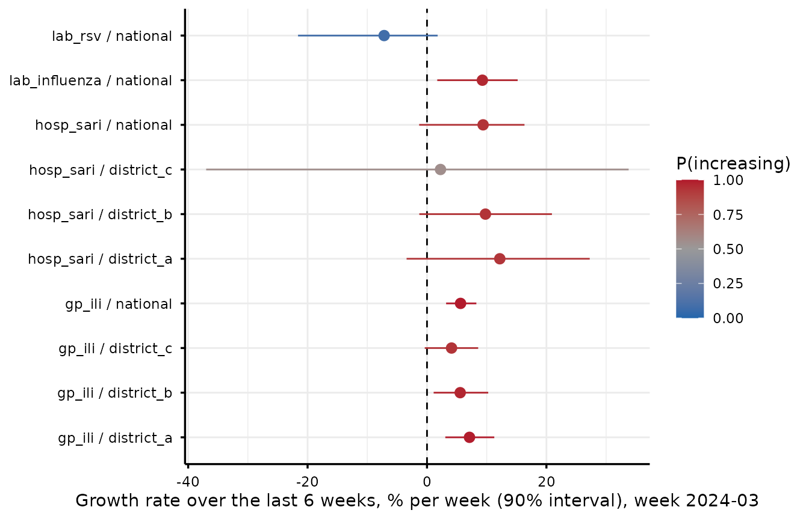

# Article 3: one pipeline over every registry

The pipeline uses the two other layers. It loads the table of every
registry package of [article
1](https://www.rwhite.no/plnr/articles/case-study-contract.md). It then
runs the methods of [article
2](https://www.rwhite.no/plnr/articles/case-study-methods.md) on every
indicator in every location, one plnr analysis for each.

## Data: one plnr data source for each registry

This article first runs the code of article 1 that makes the synthetic
registries, their tables and `check_contract()`. It does not print that
code again.

``` r
library(csalert)
library(plnr)

p <- Plan$new()
p$add_data("gp", fn = function() check_contract(get_data_gp(), "gp"))
p$add_data("hosp", fn = function() check_contract(get_data_hosp(), "hosp"))
p$add_data("lab", fn = function() check_contract(get_data_lab(), "lab"))
```

A registry that breaks the contract stops the run before any analysis
starts. A new registry needs one more `add_data()` call.

## Argsets: read from the data

The pipeline reads the indicators and the locations from the data. It
also reads two facts that decide the method. The first is whether the
indicator has a denominator. The second is whether any count arrives
after the Monday of its reference week.

``` r
d <- p$get_data()
argsets <- rbindlist(lapply(setdiff(names(d), "hash"), function(src) {
  d[[src]][, .(
    source = src,
    has_denominator = !anyNA(denominator),
    arrives_late = any(reporting_date > monday_of(isoyearweek_reference))
  ), keyby = .(indicator_tag, location_code)]
}))
argsets[, name := paste(indicator_tag, location_code, sep = "/")]
p$add_argset_from_df(argsets)
argsets[, .N, keyby = .(source, has_denominator, arrives_late)]
#> Key: <source, has_denominator, arrives_late>
#>    source has_denominator arrives_late     N
#>    <char>          <lgcl>       <lgcl> <int>
#> 1:     gp            TRUE        FALSE     4
#> 2:   hosp           FALSE         TRUE     4
#> 3:    lab            TRUE         TRUE     2
```

`p$get_data()` also returns an element `hash`, which the code above
skips. A new indicator or location in a registry needs no change to the
code.

## One action function

The action function runs the csalert methods of article 2 on one
indicator in one location. The two facts in the argset decide which
nowcast and which measure it uses. It returns the growth rate of the
newest week. Article 2 also adds the intensity levels, which this
function leaves out.

``` r
trend_fn <- function(data, argset) {
  x <- data[[argset$source]][indicator_tag == argset$indicator_tag & location_code == argset$location_code]
  tri <- csfmt_reporting_triangle_v3(x, id_cols = c("indicator_tag", "location_code", "age", "sex"))
  denominator <- if (argset$has_denominator) "denominator"
  ens <- if (argset$arrives_late) {
    nowcast_delay_ecdf_v1(tri, max_delay_days = 28, n_sim = 500, denominator_col = denominator)
  } else {
    nowcast_passthrough_to_ensemble_v1(tri, max_delay_days = 28, denominator_col = denominator)
  }
  measure <- "numerator_nowcasted"
  if (argset$has_denominator) {
    ens <- ens_add_rate(ens, numerator = measure, denominator = "denominator_nowcasted", per = 100)
    measure <- csfmt_var(measure, denom = "denominator_nowcasted", per = 100)
  }
  ens <- short_term_trend(ens, measure = measure, trend_isoyearweeks = 6, denominator = if (argset$has_denominator) "denominator_nowcasted", per = 100)
  res <- ens_collapse(ens, probs = c(0.05, 0.5, 0.95))
  gr <- csfmt_var(measure, role = "trend", suffix = "_gr")
  res[.N, .(
    indicator_tag, location_code, isoyearweek,
    growth_pct = get(csfmt_var(gr, q = 0.5)),
    growth_pct_p05 = get(csfmt_var(gr, q = 0.05)),
    growth_pct_p95 = get(csfmt_var(gr, q = 0.95)),
    p_increasing = get(csfmt_var(measure, role = "trend", suffix = "_increasing_pr"))
  )]
}

p$apply_action_fn_to_all_argsets(fn = trend_fn)
set.seed(2)
res <- rbindlist(p$run_all())
res
#>     indicator_tag location_code isoyearweek growth_pct growth_pct_p05
#>            <char>        <char>      <char>      <num>          <num>
#>  1:        gp_ili    district_a     2024-03   7.115856      3.0661256
#>  2:        gp_ili    district_b     2024-03   5.559025      1.1145332
#>  3:        gp_ili    district_c     2024-03   4.109583     -0.3784135
#>  4:        gp_ili      national     2024-03   5.620841      3.2024720
#>  5:     hosp_sari    district_a     2024-03  12.192209     -3.4173068
#>  6:     hosp_sari    district_b     2024-03   9.786429     -1.2880501
#>  7:     hosp_sari    district_c     2024-03   2.259962    -36.9866325
#>  8:     hosp_sari      national     2024-03   9.394064     -1.3142596
#>  9: lab_influenza      national     2024-03   9.275147      1.7179264
#> 10:       lab_rsv      national     2024-03  -7.180523    -21.5983251
#>     growth_pct_p95 p_increasing
#>              <num>        <num>
#>  1:      11.268934        0.992
#>  2:      10.251953        0.973
#>  3:       8.571016        0.934
#>  4:       8.266010        0.997
#>  5:      27.252624        0.928
#>  6:      20.922620        0.938
#>  7:      33.770764        0.556
#>  8:      16.326881        0.938
#>  9:      15.184068        0.968
#> 10:       1.786009        0.080
```

`run_all()` loads each registry once and runs the 10 analyses.
`run_all_parallel()` runs the same analyses in parallel.

The function builds the names of the estimate columns with
[`csfmt_var()`](https://niphr.github.io/csalert/reference/csfmt_var.html)
from the measure. The same lines therefore read a rate and a count.

## One table and one figure for every registry

The result has one row for each analysis, with the same columns for all
three registries. One figure therefore shows them all:

``` r
library(ggplot2)
pd <- copy(res)
pd[, analysis := factor(paste(indicator_tag, location_code, sep = " / "))]
q <- ggplot(pd, aes(y = analysis, x = growth_pct, xmin = growth_pct_p05, xmax = growth_pct_p95, colour = p_increasing))
q <- q + geom_vline(xintercept = 0, linetype = "dashed")
q <- q + geom_pointrange()
q <- q + scale_colour_gradient2("P(increasing)", low = "#2166ac", mid = "grey60", high = "#b2182b", midpoint = 0.5, limits = c(0, 1))
q <- q + labs(x = sprintf("Growth rate over the last 6 weeks, %% per week (90%% interval), week %s", pd$isoyearweek[1]), y = NULL)
q <- q + theme_minimal(base_size = 11)
q <- q + theme(axis.line = element_line(colour = "black", linewidth = 0.6), axis.ticks = element_line(colour = "black", linewidth = 0.6), axis.text = element_text(colour = "black"))
q
```



## The same structure at FHI

FHI runs the trend analysis of its respiratory surveillance with a
version of this structure, as [the
overview](https://www.rwhite.no/plnr/articles/case-study.md) describes.
Each registry has a function that returns a table that follows the
contract. Four plnr plans then run in sequence:

1.  **Quality control.** One analysis checks every registry and removes
    known bad records.
2.  **Trends.** One analysis for each indicator, as in this article,
    with csalert.
3.  **Tables.** One analysis makes the tables of the weekly report.
4.  **Figures.** One analysis writes the figures as image files.

A Quarto document then renders the weekly report from the saved tables.
