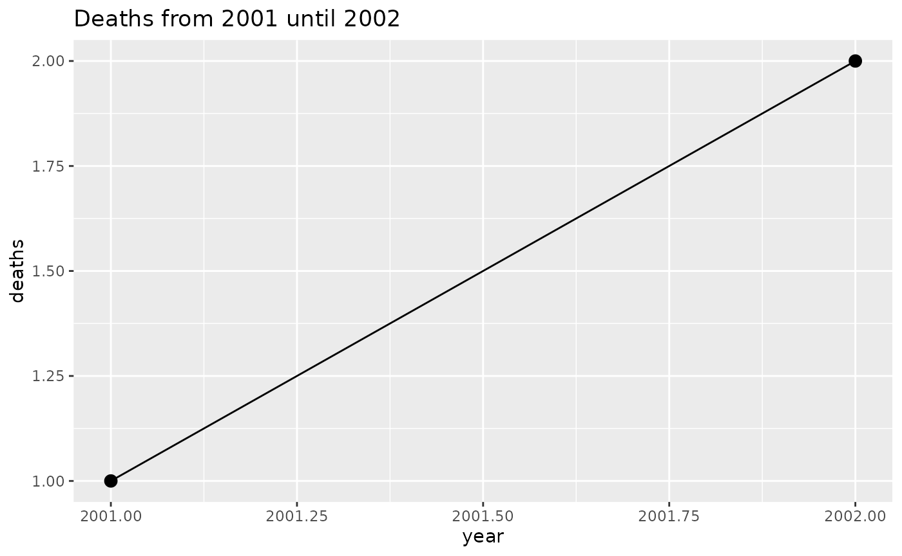

# Introduction to plnr

plnr runs many analyses on the same data. You describe the data and the
analyses in a plan, and the plan runs them.

## Core concepts

| Term | Meaning |
|----|----|
| argset | A named list of arguments for one analysis. |
| action function | A function that does one analysis. It MUST take the data as its first argument and the argset as its second. It MAY take more arguments. |
| analysis | One argset plus one action function. A plan runs analyses. |
| plan | A `Plan` object. It holds the data sources and a list of analyses. |

A plan is one of two kinds:

- A **single-function plan** applies one action function to many
  argsets. Use it for many strata, such as locations or age groups, or
  for many variables, such as exposures or outcomes.
- A **multi-function plan** applies different action functions to the
  same data. Use it for the tables and figures of one report.

[`vignette("adding_analyses")`](https://www.rwhite.no/plnr/articles/adding_analyses.md)
builds both kinds on real data.

## A first plan

``` r
library(plnr)
```

    ## plnr 2026.11.19
    ## https://www.rwhite.no/plnr/

``` r
library(ggplot2)
library(data.table)
```

    ## 
    ## Attaching package: 'data.table'

    ## The following object is masked from 'package:base':
    ## 
    ##     %notin%

``` r
p <- Plan$new()

p$add_data(
  name = "deaths",
  direct = data.table(deaths = 1:4, year = 2001:2004)
)

p$add_argset(name = "fig_1_2002", year_max = 2002)
p$add_argset(name = "fig_1_2003", year_max = 2003)

fn_fig_1 <- function(data, argset) {
  plot_data <- data$deaths[year <= argset$year_max]

  ggplot(plot_data, aes(x = year, y = deaths)) +
    geom_line() +
    geom_point(size = 3) +
    labs(title = glue::glue("Deaths from 2001 until {argset$year_max}"))
}

p$apply_action_fn_to_all_argsets(fn_name = "fn_fig_1")

p$run_one("fig_1_2002")
```



`run_one()` runs one analysis. `run_all()` runs every analysis and
returns a list of the results.

## Data

`add_data()` takes a data source in one of three forms:

- `direct`: the dataset itself.
- `fn`: a function that returns the dataset.
- `fn_name`: the name of such a function.

A data function without arguments makes one dataset for the whole plan.
`run_all()` calls `get_data()` once and passes the result to every
analysis. `run_one()` calls `get_data()` each time you call it.
`get_data()` also adds an element `hash`, with a spookyhash digest of
each dataset. plnr does not read these digests. It does not cache, so
every call of `get_data()` loads every data source again.

## Data that depends on the argset

The key fields of a data function are its arguments without a default,
other than `...`. For each analysis, the plan calls the function with
these fields of its argset. It keeps each dataset for the run, so the
analyses with the same values share one dataset. A data function without
key fields runs once, with no arguments.

This plan simulates one dataset for each scenario and simulation. It
then fits a model to each of two outcomes in each dataset:

``` r
n_calls <- 0
simulate <- function(scenario, sim) {
  n_calls <<- n_calls + 1
  set.seed(sim)
  effect <- if (scenario == "null") 0 else 0.5
  x <- rnorm(100)
  data.frame(x = x, a = effect * x + rnorm(100), b = rnorm(100))
}

sim_plan <- Plan$new()
sim_plan$add_data("sim_data", fn = simulate)
sim_plan$add_argset_from_list(expand_list(
  scenario = c("null", "real"),
  sim = 1:3,
  outcome = c("a", "b")
))
sim_plan$apply_action_fn_to_all_argsets(fn = function(data, argset) {
  d <- data$sim_data
  coef(lm(d[[argset$outcome]] ~ d$x))[[2]]
})

results <- sim_plan$run_all()
length(results)
```

    ## [1] 12

``` r
n_calls
```

    ## [1] 6

The plan ran 12 analyses and called
[`simulate()`](https://rdrr.io/r/stats/simulate.html) 6 times, once for
each of the 2 scenarios and 3 simulations. The analyses for outcomes `a`
and `b` got the same dataset.
[`simulate()`](https://rdrr.io/r/stats/simulate.html) did not get the
field `outcome`.

Each key field MUST be in every argset. The plan compares values
exactly, so `1` and `1L` make two datasets. `get_data()` needs an
analysis for such a plan:

``` r
str(sim_plan$get_data(1), max.level = 1)
```

    ## List of 2
    ##  $ sim_data:'data.frame':    100 obs. of  3 variables:
    ##  $ hash    :List of 2

The parallel runs also call the function once for each distinct set of
values. They run each group of analyses that share a value in one task,
so the number of groups limits the parallelism.
[`?Plan`](https://www.rwhite.no/plnr/reference/Plan.md) gives the
details.

## Function names

An analysis gets its action function by name or as a function object:

``` r
p$add_analysis(name = "fig_1_2002", fn_name = "fn_fig_1", year_max = 2002)
p$add_analysis(name = "fig_1_2003", fn = fn_fig_1, year_max = 2003)
```

plnr finds the function when the analysis runs. It looks in this order:

1.  The local environment where the name resolved when you added the
    analysis. This applies inside a function, or in a report knit with
    `envir = new.env()`. There, the function MUST exist before you add
    the analysis.
2.  The global environment, then the search path. A global function MAY
    come after the analysis.
3.  plnr itself.

`"pkg::fn"` names a function that a package exports.
[`?get_anything`](https://www.rwhite.no/plnr/reference/get_anything.md)
gives the full order.

A function object suits a function that another function made. The two
forms pass arguments differently, as
[`?Plan`](https://www.rwhite.no/plnr/reference/Plan.md) describes.

## Debugging

These methods show what an action function gets:

``` r
p$get_argset("fig_1_2002")
```

    ## $year_max
    ## [1] 2002

``` r
p$get_analysis(1)
```

    ## $fn
    ## NULL
    ## 
    ## $fn_name
    ## [1] "fn_fig_1"
    ## 
    ## $fn_env
    ## NULL
    ## 
    ## $argset
    ## $argset$year_max
    ## [1] 2002
    ## 
    ## $argset$index_analysis
    ## [1] 1

``` r
str(p$get_data(), max.level = 1)
```

    ## List of 2
    ##  $ deaths:Classes 'data.table' and 'data.frame': 4 obs. of  2 variables:
    ##   ..- attr(*, ".internal.selfref")=<pointer: 0x576ee2b3e190> 
    ##  $ hash  :List of 2

To develop an action function line by line, start it with
[`is_run_directly()`](https://www.rwhite.no/plnr/reference/is_run_directly.md):

``` r
fn_analysis <- function(data, argset) {
  if (plnr::is_run_directly()) {
    data <- p$get_data()
    argset <- p$get_argset("fig_1_2002")
  }
  data$deaths[year <= argset$year_max]
}
```

When you run the lines of the body in the console,
[`is_run_directly()`](https://www.rwhite.no/plnr/reference/is_run_directly.md)
returns `TRUE`, so `data` and `argset` come from the plan. When the plan
runs the function, it returns `FALSE`, and the two lines do nothing.
